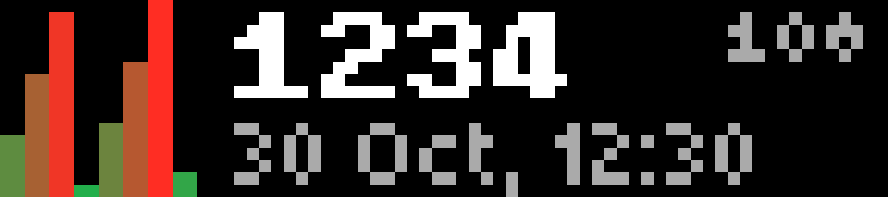
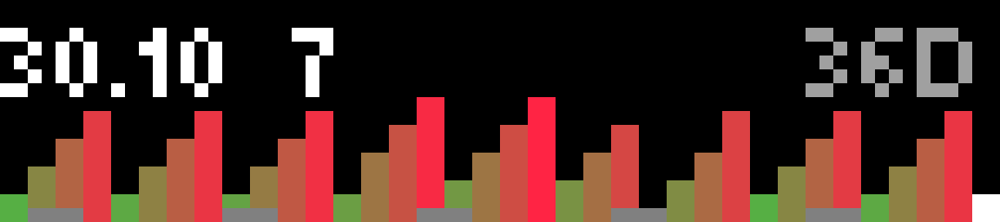

# BUSY Profit

BUSY Profit shows lifetime sales, days since launch and the latest eight days on your BUSY Bar. Press Start for the 36-day chart and turn the encoder to select a day; gray pixels mark weekends and the selected day is white. New sales appear for ten seconds over an animated chart with a cash sound, or one applause when a hundred is crossed. The subtle right-edge indicator counts down to the next one-minute refresh from [profit.busy.truetug.info](https://profit.busy.truetug.info/); press Back to exit.

## Screenshots

Sales feeds require a private PIN. After installation, open the app settings in the Bar web interface, enter **PIN**, and restart the app. The PIN is not included in this repository or release package. Public screenshots use demonstration data.

Screenshots use demonstration data. Native 72×16 catalog images: [overview](screenshots/catalog/lifetime-summary.png), [daily chart](screenshots/catalog/daily-chart.png), [new sales](screenshots/catalog/new-sales.png). Documentation images use nearest-neighbor enlargement.

## Build

Install Node.js 24 and pnpm, then run `pnpm install`, `pnpm test`, `pnpm typecheck` and `pnpm build`. Releases are packaged automatically by GitHub Actions.

The [collector](https://github.com/truetug/busy-profit-app/blob/main/backend/README.md) maintains the full sales history and publishes the compact feeds used by the app.
